# 巨轮推进系统 · 组合体三维解剖台

**Marine Propulsion Anatomy** — 186 parts · 4 configurations · machine-checked geometry · one offline HTML file.

[](https://github.com/LucasDevKid9/marine-propulsion-3d/actions/workflows/quality.yml)
[](https://lucasdevkid9.github.io/marine-propulsion-3d/)


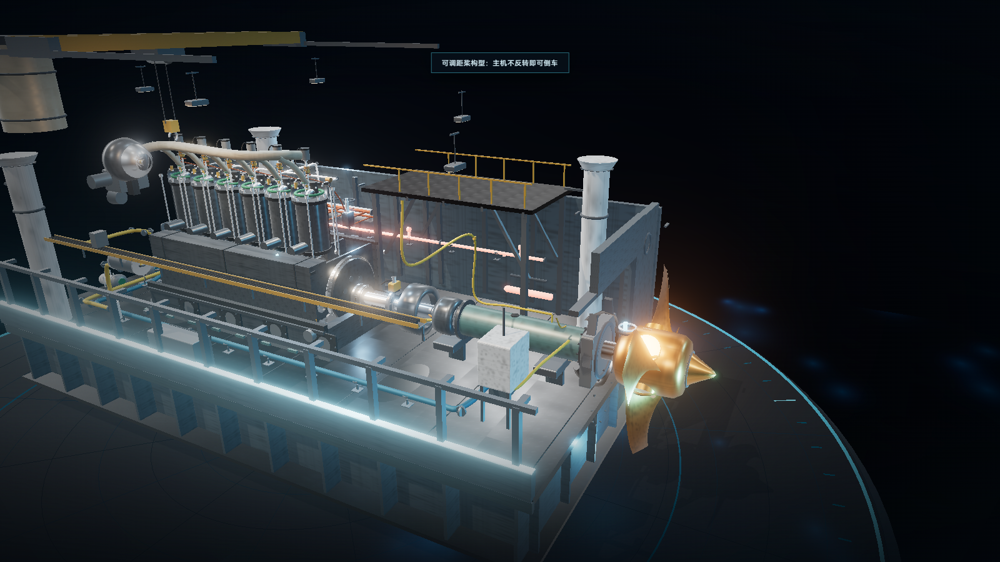

> 默认总装视图：低速二冲程十字头柴油机 + CPP 可调距桨 + 艉部剖切机舱。右舷外板敞开，可直接看到轴系与艉管密封。

一艘大型船舶的**艉部机舱 + 推进系统**被拆成 186 个可单独选中、隔离、爆炸的构件：6 缸二冲程十字头柴油机、CPP / FPP + 导管两套推进器、长轴系与艉管密封、可切换的船用燃气轮机模块，以及完整机舱环境与管系。几何与贴图全部程序化生成，**产物是单个 952 kB 的 HTML 文件，双击即可离线运行**。

**不想装任何东西？** 直接打开 [**在线 Demo**](https://lucasdevkid9.github.io/marine-propulsion-3d/)（GitHub Pages 从 `main` 自动部署），或下载仓库里的 [`dist/index.html`](dist/index.html) 双击。两者是同一份单文件产物。

---

## 30 秒判断这个仓库值不值得看

| **186** | **4** | **0** | **952 kB** |
|:---:|:---:|:---:|:---:|
| 独立构件，运行时导出可核对 | 推进构型，各自过几何门禁 | 四构型下未登记的干涉 / 走管异常 / 传动链空洞 | 无外链单文件，`file://` 直接打开 |

这不是「摆了一堆模型」的展示页。真正花力气的地方在**让几何缺陷无法悄悄存在**：传动链是一张可自检的图，干涉由机器按子网格判定，装配接触必须逐条写明工程理由，四构型门禁在 CI 里跑。首版被指出的「穿模 / 管线不合理 / 动力链断裂」正是靠这套机制定位并修掉的——完整归因见 [缺陷复盘](docs/POSTMORTEM.md) 与 [Skills 元层面反思](docs/SKILLS-RETRO.md)。

---

## 为什么它不只是又一个 three.js demo

**1 · 传动链是数据，不是摆放坐标。** [`core/driveline.js`](src/core/driveline.js) 声明 8 个法兰/轴端节点、7 个路径段（轴 / 齿轮换向 / 弹性联轴器）、2 个自由端，每段写明由哪些构件实现。`checkChain()` 做节点图自检：孤儿段、悬空节点、分支、不可达、轴线失配一律报错。燃机到中间轴的动力流不再是「几个零件看起来挨着」，而是**沿节点图连续可采样**——审计器对每段取 14 个采样点验证实现件几何确实覆盖，空洞即失败。

**2 · 几何缺陷由机器判定，不靠肉眼。** [`core/audit.js`](src/core/audit.js) 同时跑五类检查：实体子网格干涉、走管侵入块体设备、传动链覆盖空洞、节点吻合度、长跨旋转件支承。`scripts/geom-lint.mjs` 在四种构型下各跑一遍，`干涉上限 0`，任一非空即 `exit 1`。早期版本靠截图人工验收，574 处误报里混着真缺陷；现在报告可复现、可 diff、可进 CI。

**3 · 豁免必须写理由，且文档从源码生成。** 轴穿轴承、叶根坐入桨毂、艉轴穿艉管在几何上必然重叠，属于装配而非穿模。[`core/audit-allow.js`](src/core/audit-allow.js) 逐条登记 **51 条**并注明工程理由，`npm run docs:allow` 从该数组渲染出 [`docs/AUDIT-ALLOW.md`](docs/AUDIT-ALLOW.md)，CI 用 `git diff --exit-code` 校验两者同步——**改了源码却没重生成文档，流水线直接失败**。想放过一处重叠，只有改几何或写清理由两条路，不能调阈值放水。

**4 · 渲染合批与审计精度彻底解耦。** 按材质全合批会把整段管系压成一个巨型包围盒，审计无法区分「管子穿过机器」和「管子贴着机器走」。三次迭代的量化权衡：

| 方案 | draw calls | 审计空间精度 |
|---|---:|---|
| 按材质全合批 | ~900 | ✗ 整件级包围盒，语义丢失 |
| 1.6 m 空间分块 | 2,628 | ✓ 但渲染代价翻倍 |
| **留档 `solidBoxes` + 5 m 分块（当前）** | **1,982** | ✓ 合批前留存实体子网格盒，审计不再依赖渲染网格 |

合批粒度可以放大回 5 m，审计结论不变。这是整个项目里最值钱的一次架构决策。

**5 · 管路即数据。** [`assemblies/piping.js`](src/assemblies/piping.js) 只允许 x/y/z 正交走向，按管径 `bend = max(0.12, r×2.2)` 生成圆滑弯头，每 ≤2.2 m 一个 U 形管夹 + 立杆支座，每 6 m 与两端设法兰。燃油 / 滑油 / 海水 / 启动空气 / 消防五套管系加电缆桥架，全部由折线点表声明，改走向不用改几何代码。

**6 · 其余该有的都有。** 六层渐变爆炸（单一 `progress` 真值，正反向幂等）、只切壳体的平面剖切（内部曲轴/活塞/连杆保持完整）、车钟→转速→曲轴→活塞→桨叶→伺服的联动运动学、CPP 变距链、燃机七步启动时序、四段配色气流粒子、41 种程序化 PBR 配方、Canvas 生成的 27 张贴图、`RoomEnvironment` 现场烘焙 IBL、深黑海军蓝三面板 UI、390×844 移动端抽屉适配。

---

## 快速开始

```bash
npm install                 # three.js 0.187.0 版本锁定
npm run dev                 # http://127.0.0.1:5173 热更新
npm run build               # → dist/index.html（974,448 B，含全部 JS/CSS/贴图）
```

构建后**双击 `dist/index.html` 即可离线运行**，不需要服务器、不需要联网。仓库里已经带着这份构建好的单文件产物——不想装 Node 也可以直接下载 [`dist/index.html`](dist/index.html) 一个文件双击打开。

```bash
npm run lint:geom           # 四构型几何门禁（干涉上限 0，失败 exit 1）
npm run test:core           # 37 项功能与联动断言
npm run test:dist           # file:// 直接打开产物做回归
npm run test:mobile         # 390×844 触屏布局回归
npm run shots               # 重出 15 张展示图（需先 npm run dev）
npm run parts               # 从运行时重导出构件清单 → PARTS.md
npm run docs:allow          # 从源码重生成豁免表文档
```

> 自动化测试使用本机 Edge（`playwright-core` + `channel: 'msedge'`），需 Windows / macOS 上装有 Edge。CI 的 quality job 跑在 `windows-latest` 正是为此。

---

## 画廊

| 总装与爆炸 | 剖切 |
|---|---|
| 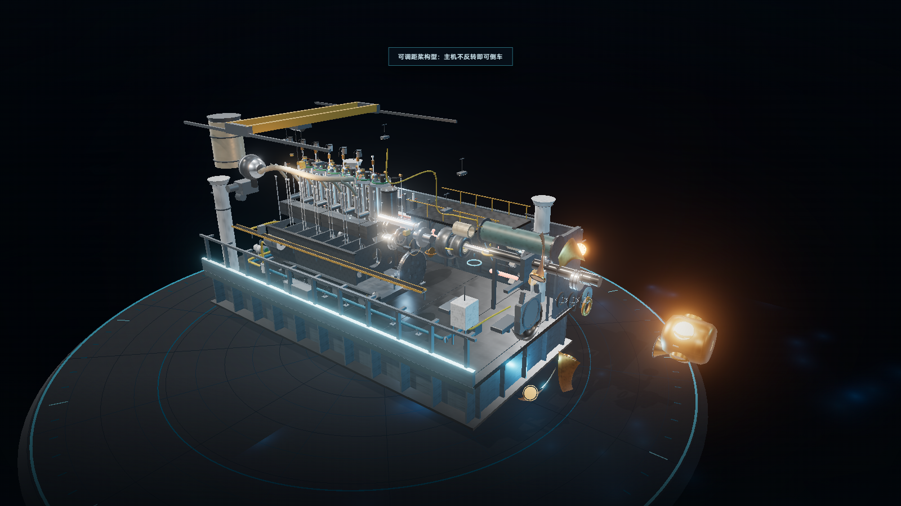 | 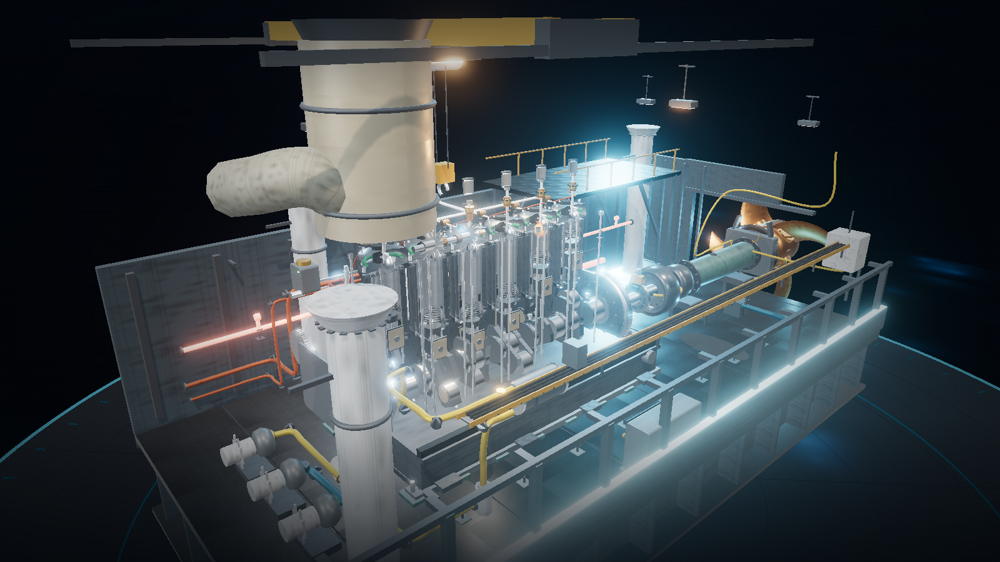 |
| 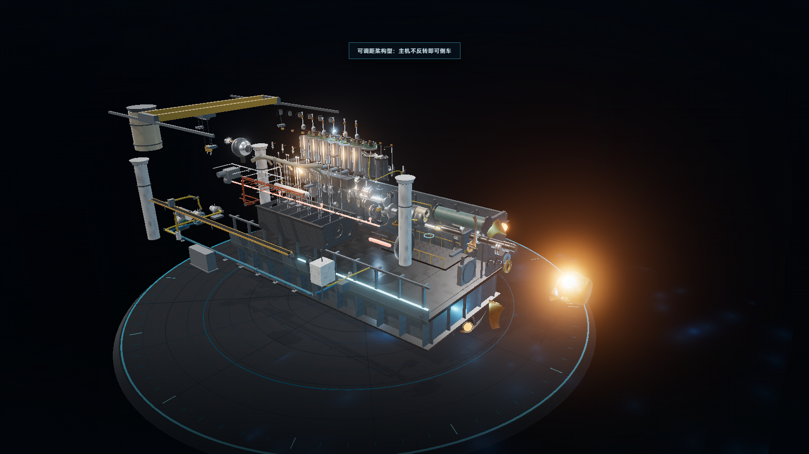 | 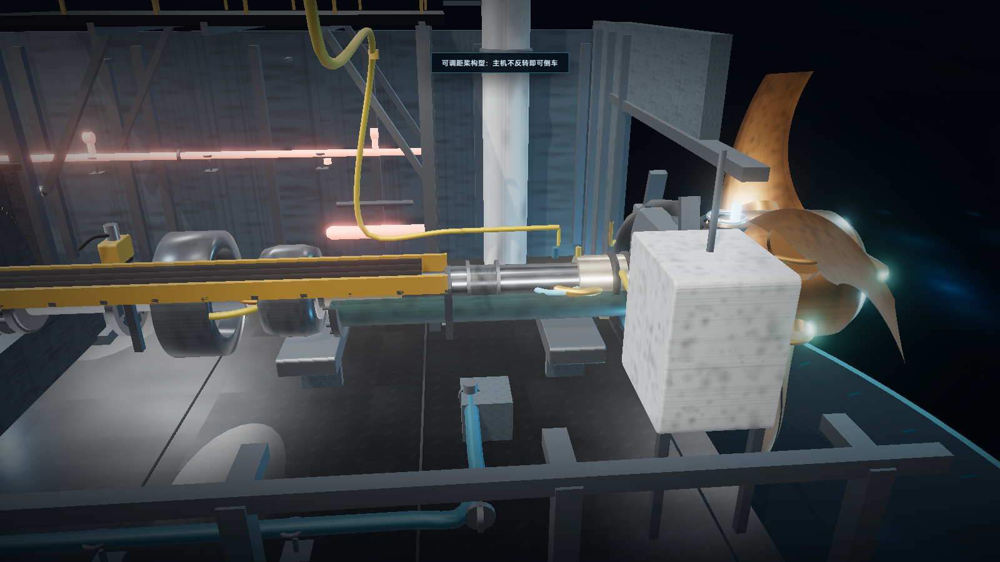 |

| 燃气轮机传动链 | 推进器 |
|---|---|
| 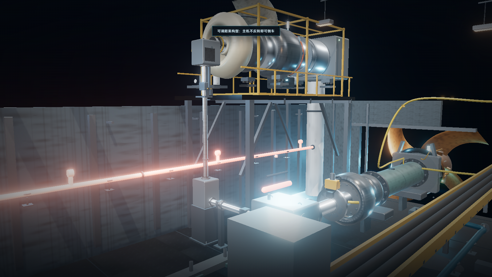 | 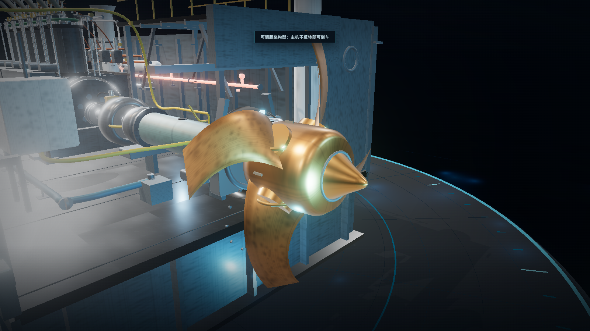 |
| 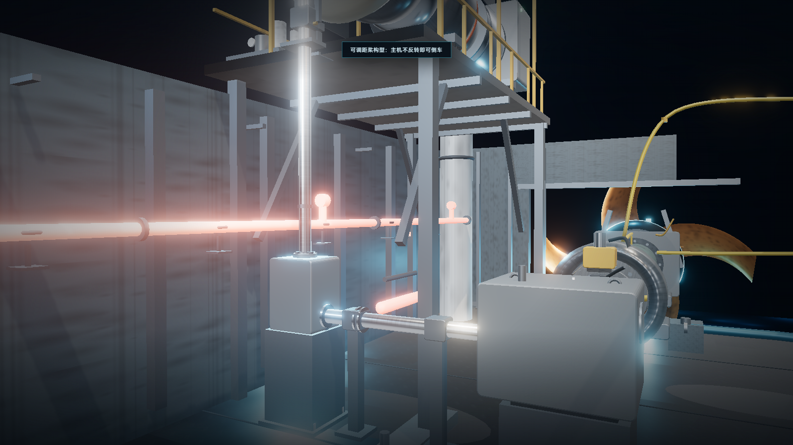 | 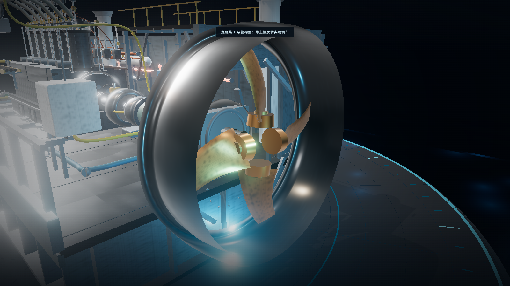 |

| 管系 | 气流与细节 |
|---|---|
| 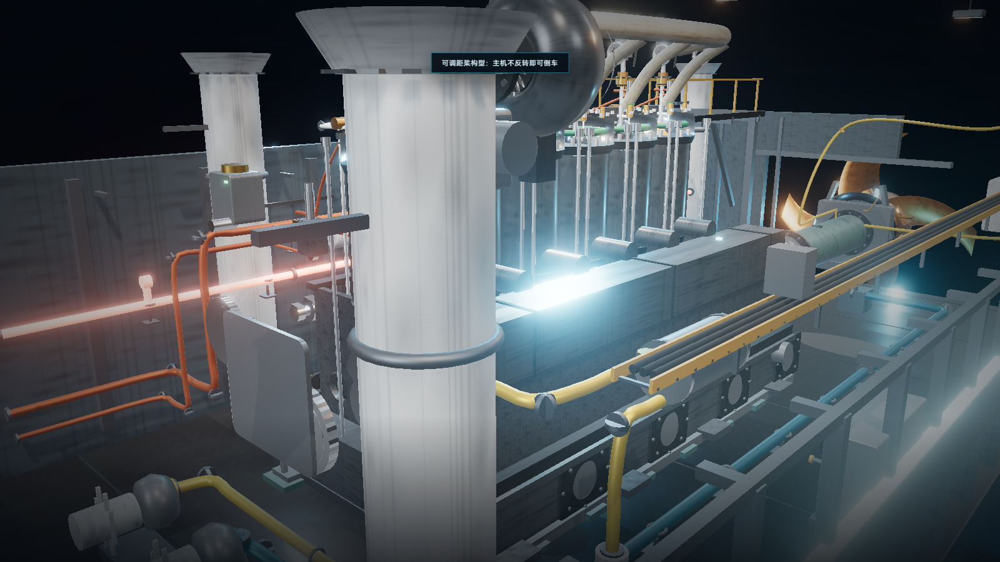 | 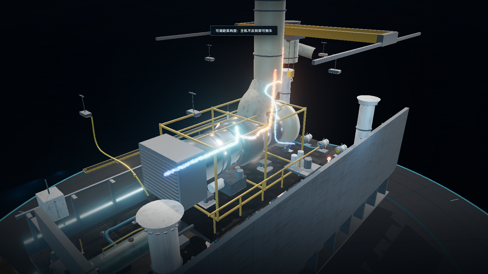 |
| 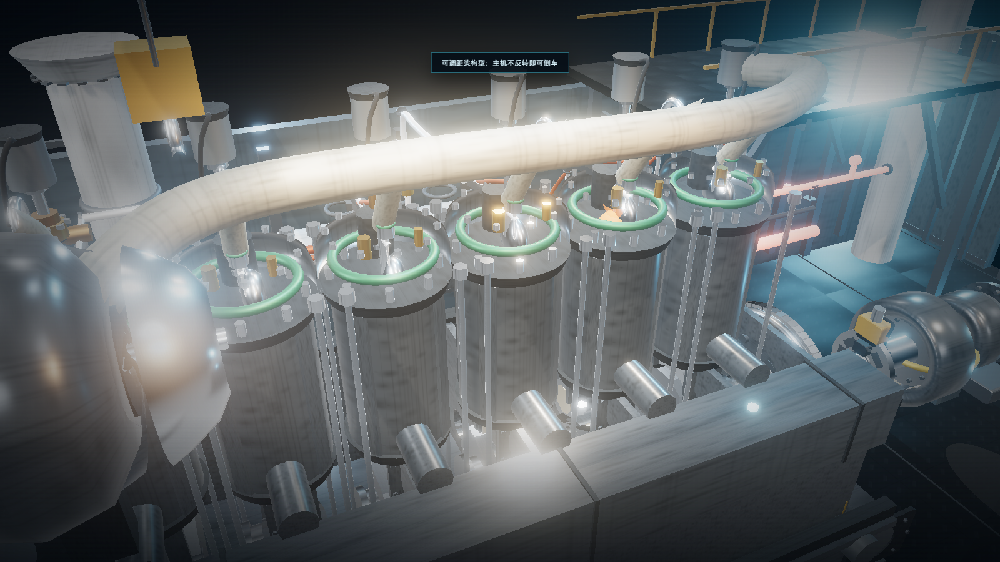 | 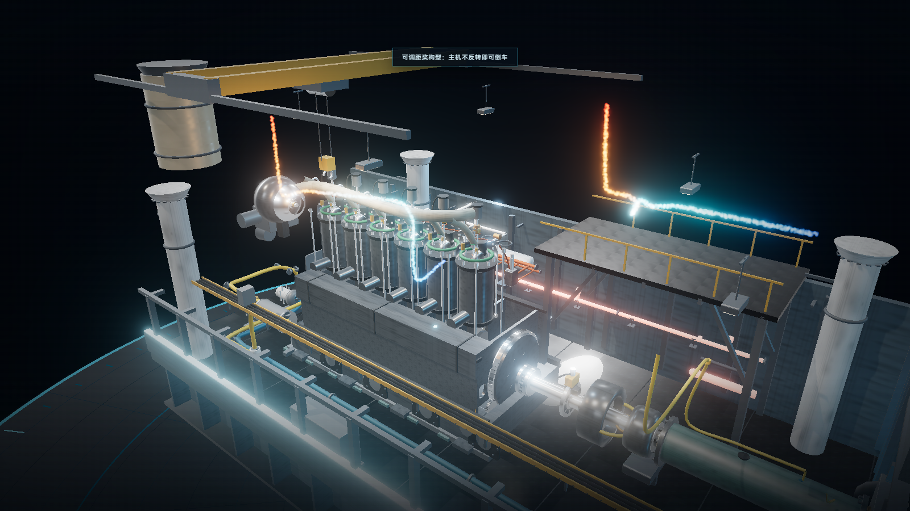 |

全部 15 张机位定义见 [`scripts/shots.mjs`](scripts/shots.mjs)：出图前统一 `pause + progress=0 + 车钟归零`，保证「同一套图描述同一台机器」，不做无依据的标注。

---

## 架构

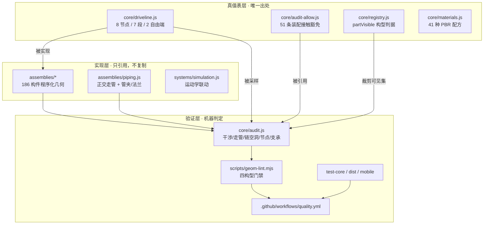

完整分层说明见 [`docs/ARCHITECTURE.md`](docs/ARCHITECTURE.md)。核心原则：**真值只写一次，实现层引用不复制；验证层读真值表反查实现，而不是靠成品外观猜**。

---

## 质量门禁

`npm run lint:geom` 的真实输出（四种构型各跑一遍，可见集按构型标签裁剪）：

| 构型 | 可见构件 | 干涉 | 走管异常 | 传动链空洞 | 节点失配 | 链图 | 已登记装配接触 |
|---|---:|---:|---:|---:|---:|:---:|---:|
| diesel / CPP | 156 / 186 | 0 | 0 | 0 | 0 | OK | 39 |
| diesel / FPP | 147 / 186 | 0 | 0 | 0 | 0 | OK | 29 |
| gas / CPP | 80 / 186 | 0 | 0 | 0 | 0 | OK | 25 |
| gas / FPP | 71 / 186 | 0 | 0 | 0 | 0 | OK | 15 |

**门禁：链图 PASS · 构型 4/4 PASS（干涉上限 0）**。豁免只作用于干涉与走管两类；传动链空洞、节点失配、链图连通性**不可豁免**。

| 回归 | 结果 | 实测要点 |
|---|---|---|
| `test:core` | **37 / 37** | 42/186 壳体被裁剪、关键运动件被裁 0；燃机 25 件在柴油构型全隐、切回全显；正反向装配位置偏差 0.00e+0；运行期无 JS 异常 |
| `test:dist` | **PASS** | `file://` 直接加载，186 构件、27 张贴图、952 kB、无报错 |
| `test:mobile` | **PASS** | 390×844 无横向溢出、抽屉可开合、底栏按钮在视口内、无 pageerror |
| `lint:geom` | **4 / 4 PASS** | 见上表；报告 JSON 由 CI 上传为 artifact |

单帧渲染实测（1600×900，`renderer.info` 口径）：**1,982 draw calls · 423,002 三角面 · 1,400 网格 · 741,480 顶点 · 27 纹理 · 49 shader programs**。这里的三角面含后处理全屏通道、粒子与多 pass 重绘，因此高于 [PARTS.md](PARTS.md) 统计的构件几何面数（255,856）——两者口径不同，不是数据冲突。

CI 分两个 job：`ubuntu-latest` 构建并校验单文件无外链（出现 `src="http…"` 即失败）；`windows-latest` 跑几何门禁 + 三项回归 + 文档同步校验 + 产物回归。

---

## 文档

| 文档 | 内容 |
|---|---|
| [docs/POSTMORTEM.md](docs/POSTMORTEM.md) | 穿模 / 管系 / 动力链断裂三类缺陷的逐条定性、根因与防复发机制 |
| [docs/SKILLS-RETRO.md](docs/SKILLS-RETRO.md) | **元层面**：为什么 AI 会稳定产出「看着对、其实错」的成果，以及可写进 Skill 的硬规则 |
| [docs/ARCHITECTURE.md](docs/ARCHITECTURE.md) | 真值表层 / 实现层 / 验证层的分层与数据流 |
| [docs/AUDIT-ALLOW.md](docs/AUDIT-ALLOW.md) | 51 条装配接触豁免表（自动生成，含工程理由与判定规则） |
| [PARTS.md](PARTS.md) | 186 件构件的 id、名称、关键零件与面数（运行时导出） |

---

## 系统构成

**四种推进构型**：柴油机直驱 + CPP（默认，靠变距正倒车）／柴油机直驱 + FPP + 导管（靠主机反转）／燃气轮机 + 减速齿轮箱 + CPP／燃气轮机 + FPP。

- **主机**：6 缸低速二冲程十字头柴油机。机座/A 字架/贯穿螺栓、气缸体与缸套扫气口、活塞头/活塞杆/十字头/导板、剖分式连杆、曲轴与平衡重、主轴承、飞轮、排气阀（空气弹簧 + 旋阀器）、扫气箱、废气涡轮增压器、喷油泵/喷油器/高压油管、凸轮轴与摇臂、调速器。运动学由曲柄销转角反解十字头高度，六缸相位差 60°。
- **轴系**：高弹性联轴器 → 中间轴（接地滑环）→ 制动盘 → 推力环 / 8 块推力块 / 油膜 → 中间轴承与甩油环 → 艉轴 → 艉管（白合金轴承 + 螺旋油槽 + 三道 FKM 唇封 + 海水平衡腔 + 重力油柜静压平衡）。
- **推进器**：CPP 桨毂 / 4 片大侧斜镍铝青铜桨叶 / 12 颗叶根螺栓 / 伺服活塞 / 曲柄销环 / 双层输油管；FPP 4 片定距桨叶 + Kort 导管。叶型为径向 30 × 弦向 12 段参数化曲面（`β = atan(P/2πr)`、`φ = skew·u^1.35`）。
- **燃气轮机**：进气滤清 → 4 级低压 + 3 级高压压气机 → 环形燃烧室（6 火焰筒）→ 2 级高压涡轮 → 2 级自由动力涡轮 → 排气蜗壳 → **上直角传动箱 → 竖直传动轴 → 下直角传动箱 → 横向传动轴 → 主减速齿轮箱 → SSS 离合器 → 中间轴**。七步启动时序每步有独立转速目标与火焰强度。
- **机舱**：双层底、花钢板走道、剖切式艉舱壁、机舱行车、三组通风筒、控制台、泵组、五套管系、电缆桥架、消音器、重力油柜。

完整清单见 [PARTS.md](PARTS.md)。界面与快捷键、六层爆炸进度窗口见下方 [操作](#界面与操作)。

---

## 界面与操作

| 区域 | 内容 |
|---|---|
| 顶栏 | 三种视图（装配 / 爆炸 / 剖切）、气流、标签、X-Ray、FPS |
| 左栏 | 构件树（六大层级 → 子系统）、搜索、单独显隐、全部显示 / 折叠 |
| 右栏 | 视图与剖切、推进构型、驾驶台车钟、燃机时序、轴系/密封/制动、辅机与单缸熄火、实时参数 |
| 底栏 | 开始 / 暂停 / 继续 / 反向 / 重新装配、0–100% 进度滑块、六层快速定位、转速/螺距/推力 |
| 画布 | 拖拽旋转、滚轮缩放、点击拾取、悬浮提示 |

快捷键：`空格` 播放/暂停、`R` 反向、`F` 气流、`Esc` 取消选中。

| 层 | 层级 | 进度窗口 |
|---|---|---|
| 1 | 螺旋桨总成 | 0%–50% |
| 2 | 艉轴与艉管密封 | 9%–59% |
| 3 | 中间轴与推力轴承 | 18%–68% |
| 4 | 主机柴油机 / 燃气轮机 | 27%–77% |
| 5 | 机座与隔振支撑 | 36%–86% |
| 6 | 辅助管路与控制系统 | 45%–95% |

各层 `easeInOutCubic` 平滑进出，相邻层重叠 41%，不会「一层跳完再跳下一层」。播放推进、滑块拖动、层级定位共享同一 `progress`，正反向幂等。

---

## 已知限制

**几何精度** — 这是参数化工程示意模型，**不是制造级 CAD**：无公差与加工特征；桨叶为参数化近似（非 B 系列 / KaMeWa 型值表），不能用于性能计算或 CFD；燃机内部级数与叶片数已简化，不代表任何具体型号；机舱布置按单桨散货/油轮艉部通例设计，未对照实船图纸。

**物理与仿真** — 燃烧、气流粒子、油膜、火焰均为视觉化表现，不是燃烧学 / 流体力学求解；转速、螺距、推力用阻尼收敛做运动学联动，不是真实调速器与推进特性曲线；燃机启动时序为脚本状态机，数值为示意值。

**渲染** — 单平面裁剪，不支持多剖切面；气流粒子穿透显示（`depthTest:false`）会浮在机壳前方，属刻意的可视化选择；`low` 性能档关闭 Bloom；HTML 投影标签在构件密集时可能重叠；阴影贴图分辨率有限。

**性能** — 无头 Edge 软件光栅实测不代表真机 GPU 帧率，未做真机基准；1,400 个绘制网格在中低端移动机型可能掉帧，`detectPerf()` 会自动降像素比并关闭 Bloom；952 kB 单文件首次解析约 1–2 秒加载幕。

**未实现** — 无音频、无后端与持久化（刷新即回初始态）、不做截图/模型导出、不做动画时间轴回放、无 WebGPU 路径。

---

## 目录结构

```
marine-propulsion-3d/
├── index.html                 页面骨架（顶栏 / 三面板 / 底栏 / 信息卡）
├── vite.config.js             vite-plugin-singlefile 构建配置
├── src/
│   ├── core/                  driveline / audit / audit-allow / registry / utils
│   │                          textures / materials / explode / section / flow / labels
│   ├── assemblies/            environment / diesel / cpp / shafting / gasturbine / piping
│   ├── systems/simulation.js  运动学与联动
│   └── ui/                    ui.js / ui.css
├── scripts/                   geom-lint · test-core/dist/mobile · shots · export-parts/allow
├── docs/                      POSTMORTEM · SKILLS-RETRO · ARCHITECTURE · AUDIT-ALLOW
├── .github/workflows/         quality.yml（构建 + 几何门禁 + 三项回归）
├── shots/                     15 张展示图 + 机器可读的清单/测试报告
├── PARTS.md                   186 件构件清单（运行时导出）
└── dist/index.html            单文件产物（974,448 B）
```

---

## English

A single-page, **fully offline** WebGL anatomy of a large vessel's aft engine room and propulsion train: a 6-cylinder low-speed two-stroke crosshead diesel, switchable CPP / FPP + duct propellers, a long shaftline with stern-tube sealing, and an alternative marine gas-turbine module — **186 individually selectable parts**, six-layer exploded view, shell-only clipping, coupled kinematics, procedural geometry and 27 Canvas-generated textures, compiled into one 952 kB HTML file.

What makes it different from a typical three.js showcase is the **verification layer**: the drivetrain is a self-checking node graph (8 nodes / 7 segments), a geometric linter runs five checks across all four configurations with a hard **zero-interference gate** in CI, and all 51 legitimate assembly contacts are registered with engineering reasons in a generated, diff-checked document. See [`docs/POSTMORTEM.md`](docs/POSTMORTEM.md) for how the first release's clipping / piping / broken-drivetrain defects were found and structurally prevented.

```bash
npm install && npm run dev        # http://127.0.0.1:5173
npm run build                    # dist/index.html — open with file://, no server needed
npm run lint:geom                # 4/4 configurations PASS, zero-interference gate
```

MIT · built with three.js r0.187.0, Vite 6, vite-plugin-singlefile; verified with Playwright + system Edge.
